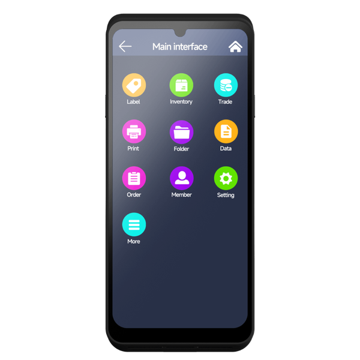
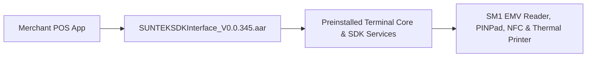

<div align="center">
  <a href="https://www.suntekai.com">
    <picture>
      <source media="(prefers-color-scheme: dark)" srcset="./assets/logo-dark.png">
      <source media="(prefers-color-scheme: light)" srcset="./assets/logo-light.png">
      
    </picture>
  </a>

  <h1>SUNTEK SM1 Smart POS Android SDK</h1>

  <p>
    <strong>Official Hardware SDK &amp; Developer Kit</strong> &middot; <em>Enjoy Smarter Service</em><br>
    Official payment terminal card-reader, EMV L2, PINPad, and thermal printer SDK (<code>V0.0.345</code> + legacy <code>V0.0.1</code>) for <strong>SUNTEK SM1</strong> handheld POS terminals (<strong>SUNTEK Technology Co., Ltd.</strong>).
  </p>

  <p>
    <a href="./LICENSE"></a>
    <a href="https://github.com/SUNTEK-Official/suntek-sdk-sm1/releases"></a>
    
    <a href="https://www.suntekai.com/products/handheld-pos-terminal-sm1/"></a>
    <a href="mailto:support@suntekai.com"></a>
  </p>

  <p>
    <a href="#hardware-showcase--compatibility">Hardware</a> &nbsp;&bull;&nbsp;
    <a href="#architecture--key-capabilities">Architecture</a> &nbsp;&bull;&nbsp;
    <a href="#supported-interfaces--physical-connections">Interfaces</a> &nbsp;&bull;&nbsp;
    <a href="#5-minute-quick-start">Quick Start</a> &nbsp;&bull;&nbsp;
    <a href="#sample-apps--prebuilt-downloads">Downloads</a> &nbsp;&bull;&nbsp;
    <a href="#troubleshooting--faq">FAQ</a> &nbsp;&bull;&nbsp;
    <a href="#documentation-changelog--support">Support</a>
  </p>
  
</div>

---

## Hardware Showcase & Compatibility

<table>
  <tr>
    <td align="center" width="38%">
      <a href="https://www.suntekai.com/products/handheld-pos-terminal-sm1/">
        
      </a>
      <br>
      <strong>SM1</strong><br>
      <sub>Smart Mobile Handheld POS with GMS</sub><br>
      <a href="https://www.suntekai.com/products/handheld-pos-terminal-sm1/">Official Product Page</a>
    </td>
    <td valign="top" width="62%">
      <ul>
        <li><strong>Payment Kernel</strong>: EMV L2, IC / Magstripe / NFC contactless, and secure PINPad</li>
        <li><strong>Built-In Printer</strong>: Integrated thermal receipt printer &amp; e-signature receipt compression</li>
        <li><strong>Dual Firmware Compatibility</strong>: Ships current <code>V0.0.345</code> and legacy <code>V0.0.1</code> AARs + PDFs</li>
        <li><strong>Full Hardware Test Demo</strong>: Complete <code>sample-android/SUNTEKSDKDemo</code> ready to open &amp; test</li>
      </ul>
    </td>
  </tr>
</table>

| Product Model | Chipset / Board | OS Versions | Build Identifier | Status |
| :--- | :--- | :--- | :--- | :---: |
| **SM1 (Current Firmware)** | Smart POS ARM Platform | Android 11 - 14 (PCI PTS) | `SUNTEKSDKInterface V0.0.345` | Supported |
| **SM1 (Legacy Batch)** | Smart POS ARM Platform | Android 11 (2025-07 Service) | `SDKInterface V0.0.1` | Supported |

> [!IMPORTANT]
> Verify your device **Model** and **Build Number** under Android **Settings -> About device** before integration. Customer applications use your own Google Play or enterprise release certificate.

---

## Architecture & Key Capabilities

- **Full Smart POS Suite**: EMV card reading, contactless NFC polling, PCI PIN entry, UART, secondary LCD, and integrated receipt printing.
- **Production Binary Fidelity**: Bundles both current `SUNTEKSDKInterface_202607201428_V0.0.345_345_release.aar` and legacy `SDKInterface_202507251719_V0.0.1_1.aar`.
- **Zero Hardcoded Keys or Servers**: Signing keystores removed from Gradle and internal server endpoints externalized.



---

## Supported Interfaces & Physical Connections

| Hardware Feature | Interface Type | Device Path / Service Target | Notes |
| :--- | :--- | :--- | :--- |
| **Current POS SDK AAR (V0.0.345)** | Binder IPC (`com.szanfu.sdk.api`) | `sdk/SUNTEKSDKInterface_202607201428_V0.0.345_345_release.aar` | Matches 2026-07 SM1 core & SDK service APKs |
| **Legacy POS SDK AAR (V0.0.1)** | Binder IPC (`com.android.sdk.api`) | `sdk/legacy/SDKInterface_202507251719_V0.0.1_1.aar` | Matches 2025-07 initial SM1 core & SDK service APKs |
| **Preinstalled System Services** | Core & SDK Service APKs | `GitHub Releases Assets` | Verify SHA-256 in Releases before provisioning |

---

## Repository Directory Layout

```text
suntek-sdk-sm1/
├── assets/                 # Official SUNTEK logos, hero banner & SM1 product render
├── sdk/
│   ├── SUNTEKSDKInterface_202607201428_V0.0.345_345_release.aar
│   └── legacy/SDKInterface_202507251719_V0.0.1_1.aar
├── docs/
│   ├── SUNTEK-POS-SDK-Development-Guide-v0.345.pdf
│   └── Legacy-POS-SDK-Development-Guide-v0.0.1.pdf
├── sample-android/         # Complete Android Studio SUNTEKSDKDemo multi-module project
├── README.md
├── LICENSE
├── THIRD_PARTY_NOTICES.md
└── CHANGELOG.md
```

> All installers (`.exe`), compiled sample APKs (`.apk`), and large binary packages (> 5 MB) are hosted on [**GitHub Releases**](https://github.com/SUNTEK-Official/suntek-sdk-sm1/releases) with `SHA256SUMS.txt`.

---

## Prerequisites & Permissions

- **Platform Target**: `minSdk 25` / `targetSdk 29`
- **App Signing Requirement**: Customer business apps sign with your own release key and bind to preinstalled terminal payment services. Configure your own debug/release `signingConfig` locally when building `sample-android/` (`KEYSTORE_*` removed from Git).
- **Required Permissions / Capabilities**: POS card reader, NFC, camera barcode scan, and Bluetooth printer permissions.
> [!NOTE]
> **PCI Security & Integrity Notice**: Preinstalled terminal security APKs are published via official **GitHub Releases** with immutable `SHA-256` checksums. Always provision payment host URLs and key injection profiles dynamically via secure MDM or merchant configuration.


---

## 5-Minute Quick Start

### Step 1: Add Current POS SDK AAR

```gradle
dependencies {
    implementation files('libs/SUNTEKSDKInterface_202607201428_V0.0.345_345_release.aar')
}
```

### Step 2: Open Full Hardware Test Suite

Open `sample-android/` in Android Studio (`:SUNTEKSDKTest`, `:SystemLib`, `:zxing`) to test IC/Magstripe/NFC cards, EMV L2 flows, PINPad, secondary LCD, and thermal receipt printing.

### Build & Run Sample Project

```bash
cd sample-android && ./gradlew :SUNTEKSDKTest:assembleDebug
```

---

## Sample Apps & Prebuilt Downloads

Verified prebuilt APKs, offline SDK bundles, and checksum manifests are published on [**GitHub Releases**](https://github.com/SUNTEK-Official/suntek-sdk-sm1/releases). Verify downloaded archives before production deployment:

```bash
shasum -a 256 -c SHA256SUMS.txt
```

---

## Troubleshooting & FAQ

<details>
<summary><b>Should I use `V0.0.345` or `legacy/SDKInterface V0.0.1`?</b></summary>
<p>Match your terminal firmware's preinstalled SDK service package (`V0.0.345` for current firmware batches, or `legacy/SDKInterface_202507251719_V0.0.1_1.aar` for 2025-07 batches).</p>
</details>

<details>
<summary><b>Where are the preinstalled terminal service APKs?</b></summary>
<p>Verified service APKs and new SDK releases are published under SemVer tags on GitHub Releases with `SHA256SUMS.txt`.</p>
</details>

<details>
<summary><b>Does my payment app require a platform signature?</b></summary>
<p>Business UI and transaction routing apps sign with your own release key and communicate via terminal IPC.</p>
</details>

---

## Documentation, Changelog & Support

- **Changelog**: [CHANGELOG.md](./CHANGELOG.md)
- **Developer Documentation Portal**: [suntek-docs](https://github.com/SUNTEK-Official/suntek-docs)
- **Technical Support**: [support@suntekai.com](mailto:support@suntekai.com)
- **Bug Reports**: [Open an Issue](https://github.com/SUNTEK-Official/.github/issues/new/choose)
- **Security Disclosures**: See [SECURITY.md](https://github.com/SUNTEK-Official/.github/blob/main/SECURITY.md) or email [support@suntekai.com](mailto:support@suntekai.com)

---

<div align="center">
  
  <br><br>
  <strong>SUNTEK Technology Co., Ltd.</strong> &mdash; <em>Smart Commercial Terminal Hardware Manufacturer Since 2010</em><br>
  <sub>80+ Export Countries &middot; 5,000,000+ Terminals Shipped &middot; 500+ ODM Projects &middot; ISO 9001 / ISO 14001 / ISO 27001 / CE / RoHS</sub><br>
  <sub><a href="https://www.suntekai.com">www.suntekai.com</a> &middot; Copyright &copy; 2026 SUNTEK Technology Co., Ltd. All rights reserved.</sub>
</div>
